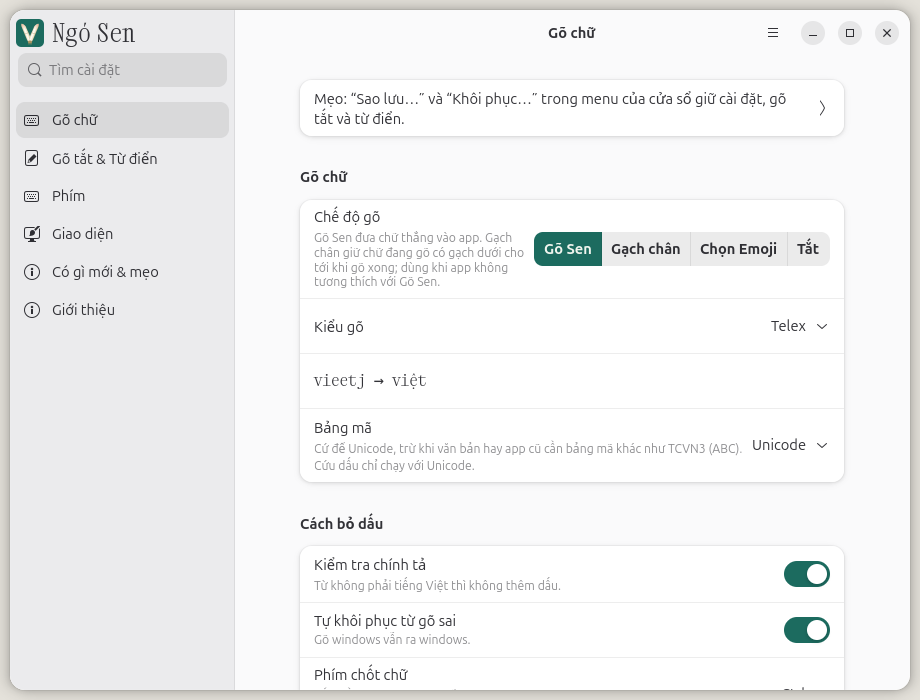
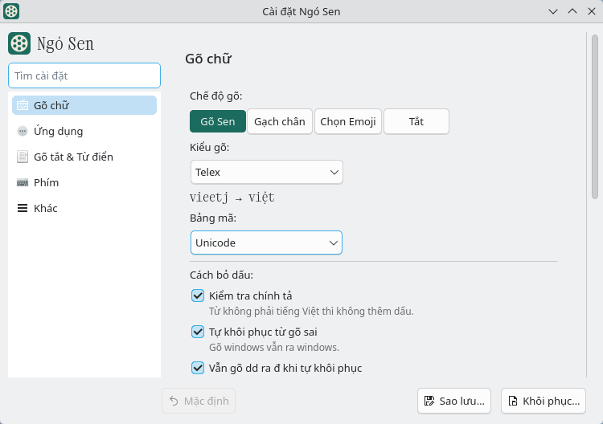

[Tiếng Việt](README.md)

# Ngó Sen

Ngó Sen is a Vietnamese input method for fcitx5 on Linux that types like UniKey on Windows.
fcitx5 runs on GNOME, KDE, Xfce, Sway and Hyprland, has many features and uses little RAM.
[Ngó Sen for GNOME](https://github.com/ngosen/ibus-ngosen) runs on GNOME's built-in IBus and shares the same
typing core as the fcitx5 version, so their features are almost identical. New features may reach the IBus
version later than the fcitx5 version.

The settings window comes in two versions: Qt and GTK (styled like GNOME apps). GNOME and Linux Mint
(Cinnamon) open the GTK version; other desktops open Qt. On KDE and GNOME, the window follows the system's
light or dark theme. Changes are saved immediately, with a "Hoàn tác" (Undo) button.

GTK version on GNOME:

<picture>
  <source media="(prefers-color-scheme: dark)" srcset="docs/screenshots/settings-gtk-dark.png">
  
</picture>

Qt version on KDE Plasma:

<picture>
  <source media="(prefers-color-scheme: dark)" srcset="docs/screenshots/settings-dark.png">
  
</picture>

## Main features

- Cứu chữ (convert text typed before switching to Vietnamese): if you forgot to enable Vietnamese and
  typed `tieengs vieetj`, press the key to switch to Vietnamese and the text becomes `tiếng việt`.
  Tab or Esc restores what you typed. If the text contains a word that cannot be converted, such as
  `abc`, Ngó Sen only shows a suggestion; press Enter to accept it. Cứu chữ remembers nothing in password fields.
- Cứu dấu (add, change or remove a tone mark): select a word and type a tone key, such as
  `nhanh` + `s` → `nhánh`. In Gõ Sen (direct typing, no underline), you can also click just after a word
  and type a tone key without selecting it: `nhanh|` + `s` → `nhánh`.
  This works in apps that let the input method read surrounding text. Chromium, Vivaldi, Cốc Cốc and WPS
  on X11 also support it through selected text. Tab or Esc restores the keys you typed.
  OnlyOffice does not support it yet, because the app reports neither surrounding text nor selected
  text to the input method. Tested with OnlyOffice 10.0.0 Document Editor on X11. Typing a tone key
  replaces the selected text as normal typing would. Ctrl+Z restores the text.
- Per-app mode menu: press `` ` `` to open a menu next to the cursor.
  Choose "Gõ Sen" (key 1), "Gạch chân" (preedit with an underline, q), "Chọn Emoji" (emoji picker, w)
  or "Tắt" (off, e); Ngó Sen remembers the choice for that app. Select the app's original mode again
  (usually Gõ Sen) to return to the global settings; choosing "Tắt" is still remembered for that app.
  The menu only opens while Vietnamese is enabled.
- "Chọn Emoji": type an English keyword such as `smile` or `heart`. An emoji list appears next to the
  cursor; press a number to choose one.
- Separate English/Vietnamese toggle: new installations use Ctrl+Shift, as in UniKey; existing installations keep
  Ctrl+Space. In English mode, typing works as if no input method were active. Each app remembers its
  English or Vietnamese choice across logouts; apps where you have not used the toggle follow its most
  recent setting.
- Typing English while Vietnamese is enabled: words that cannot become Vietnamese revert to the exact
  keys you typed, usually as you type and at the latest when you press Space. Measured with Telex and
  default settings on 9,884 common English words: 92.9% are correct before Space and 96.9% after Space.
  Most of the remaining 3.1% match the keystrokes for a Vietnamese word: `this` → `thí`, `is` → `í`,
  `has` → `há`, `too` → `tô`, `been` → `bên`, `car` → `cả`, `test` → `tét`, `box` → `bõ`;
  a few are proper names with doubled letters (`russia` → `rusia`). To keep English, double the tone key:
  `thiss` → `this`, `russsia` → `russia`.
- Word finalization key: press and release Ctrl alone (the default) to keep the word as displayed,
  without adding tone marks or expanding macros. The next key starts a new word. For example, type
  `tunx`, press and release Ctrl, then press Space to keep `tũn`.
- Macros: with "Gõ tắt chữ hoa" enabled, a `ko` → `không` macro expands `Ko` to `Không`.
  Content that already contains uppercase letters stays unchanged: with `ip` → `iPhone`, typing `Ip`
  still produces `iPhone`.
- Tray menu: switch quickly between Telex and VNI, or toggle individual automatic capitalization options,
  useful when typing terminal commands. You can hide less-used items on the "Giao diện" (Appearance) page;
  "Cài đặt" (Settings) and "Lưu nhật ký gõ" (save typing log) are always shown.
- Settings window: pages include "Gõ chữ" (Typing), "Gõ tắt" (Macro), "Phím" (Keys), "Giao diện"
  (Appearance), "Có gì mới & mẹo" (What's new & tips), "Kiểm tra máy" (Check my machine) and "Giới thiệu"
  (About). "Phím" includes the "Phím tắt" (Shortcuts) tab. Options on the "Gõ chữ" page, the "Phím tắt"
  tab of the "Phím" page, and the "Giao diện" page have short explanations, often with examples.
  The "Giao diện" page has a tray icon preview and an interface language selector.
  "Có gì mới & mẹo" explains new features and typing tips. After an update to a version with new
  features, a notification appears once to open this page.
  The "Giao diện" page has a button to switch to the other settings window (Qt or GTK) and install it
  if needed. GTK requires libadwaita 1.5 or later (Ubuntu 24.04, Linux Mint 22, Debian 13);
  Debian 12 only has the Qt version.
- "Kiểm tra máy" page: shows setup steps, the number of issues still to fix, and buttons to fix each one
  or "Sửa cả N việc" (fix all N issues). It includes a typing field, a way to test an app with a typing log,
  and options to send results through Facebook or GitHub, or copy them.

See [CHANGELOG.md](CHANGELOG.md) for details of each version.

## Which mode to use

Ngó Sen has two modes: Gõ Sen and Preedit. Use Gõ Sen as your main mode: open Ngó Sen settings,
go to "Gõ chữ" and select "Gõ Sen" in the "Chế độ gõ" (typing mode) row.

Gõ Sen sends text straight to the app, without an underline. Suggestions in address bars and search
fields update with each key. Browsers, terminals, Zalo and LibreOffice all use Gõ Sen; Ngó Sen detects
how the app receives text, so you do not need to switch modes.

Telex is used and tested daily. VNI and other input styles work but have not been tested thoroughly.

## Install

The command below installs on Fedora, Ubuntu (24.04 or later), Debian (12 or later), Kali, deepin, LMDE,
Devuan, Parrot, Arch, Artix, CachyOS and openSUSE Tumbleweed on x86_64. Ubuntu 22.04 and Linux Mint 21 can
use versions up to 1.6.4. Fedora, Ubuntu, Debian and Kali also have ARM 64-bit (aarch64) packages:

```
curl -fsSL https://raw.githubusercontent.com/ngosen/ngosen/main/install.sh | bash
```

The command downloads the package for your distro from the
[latest release](https://github.com/ngosen/ngosen/releases/latest), checks its SHA-256 hash and asks
before installing. Run it again to update to a new version; existing settings are kept.

The command adds Ngó Sen to the input method list and sets it up for your desktop:

- GNOME (Ubuntu's default desktop): replaces IBus with fcitx5 and enables the typing fix extension when
  needed. If there is no system tray (as on Fedora), it adds the
  [Input Method Panel](https://extensions.gnome.org/extension/261/) extension so the input method icon
  and menu appear in the top bar.
- KDE Plasma (Wayland): selects fcitx5 in System Settings → Virtual Keyboard so Qt apps such as Kate
  and Dolphin can also use it.
- Xfce, Cinnamon, MATE (X11, Debian and Ubuntu): uses im-config to set fcitx5 as the input method.
- Sway, Hyprland: run the one-line installer from a terminal in your desktop session to add Ngó Sen to
  the input method list and start fcitx5. No logout is needed; just press the toggle key to start typing.
  The installer does not edit your desktop config. To start fcitx5 automatically on your next login,
  paste the command it prints. If Sway has no user config yet, also run the command printed earlier
  to copy the system config.

On other desktops, log out and back in after installation. Press and release Ctrl+Shift, as in UniKey, to switch
between English and Vietnamese; the tray icon shows V while Vietnamese is enabled. If you installed
Ngó Sen before, your existing toggle key remains (usually Ctrl+Space). To change it, open settings,
go to "Phím", then the "Phím tắt" tab.
Setup only applies to the account running the command. Other accounts on the same machine need to
log in and run the installer again.

### Choose the fcitx5 or IBus version

On the first installation on GNOME, or on Xfce, Cinnamon and MATE using X11 on Debian, Ubuntu and Linux
Mint, the installer asks which version to use if the distro has an IBus package:

1. fcitx5 (recommended): all features; press Enter to select it.
2. IBus: uses the built-in IBus, with almost identical features thanks to the shared typing core.
   New features may arrive later than in the fcitx5 version.

With `--yes`, the installer skips the question and installs the fcitx5 version. Both versions use
Ctrl+Shift to switch between English and Vietnamese.

The [IBus version](https://github.com/ngosen/ibus-ngosen) (package `ibus-ngosen`) shares the fcitx5
version's typing core: Gõ Sen, input styles, macros, custom dictionary and custom keymap. It also lets
you choose Gõ Sen or "Gạch chân" per app (press `` ` `` to choose). Remaining differences: no
"Chọn Emoji" yet. Cứu dấu works in fields using Gõ Sen (click just after a word and type a tone key);
changing the tone of selected text only works in X11 apps. Cứu chữ is currently only available on X11.
In some apps, the word being typed is underlined.

To select the IBus version directly:

```
curl -fsSL https://raw.githubusercontent.com/ngosen/ngosen/main/install.sh | bash -s -- --ibus
```

Or select the fcitx5 version directly:

```
curl -fsSL https://raw.githubusercontent.com/ngosen/ngosen/main/install.sh | bash -s -- --fcitx5
```

When you run the installer again to update, it keeps the version already installed without asking
again. To switch, run it with `--ibus` or `--fcitx5`.

The two packages cannot be installed together. Switching removes the other package for all accounts
on the machine. On Debian, Ubuntu and Fedora, the old package is removed in the same installation
transaction, so it remains if installation fails. On openSUSE and Arch, the installer stops and prints
the command to remove the other package; remove it, then run the installer again.

When switching from fcitx5 to IBus, the IBus version copies the input style, macros, custom keymap and
custom dictionary from the fcitx5 version on its first run. The installer removes the fcitx5 setup it
created for this account and adds "Tiếng Việt (Ngó Sen)" to GNOME's input sources. On Xfce, Cinnamon
and MATE, it uses im-config to set IBus as the input method and adds Ngó Sen to IBus. Then log out and back in.

When switching from IBus to fcitx5, settings are not copied automatically. Before switching, back up
your settings in the IBus version's settings window, then restore them in the fcitx5 version.
The installer removes the IBus "Tiếng Việt (Ngó Sen)" input source from the account running the command;
other accounts must remove it themselves in GNOME Settings → Keyboard.

See the [IBus README](https://github.com/ngosen/ibus-ngosen#readme) for details and limitations.

### Update through your package manager

Since version 1.5.3, every release is available in signed repos, so you can get new versions through
system updates: `dnf upgrade`, `apt upgrade`, `pacman -Syu` or `zypper up`.

You only need to add the repo once. If you already used the one-line installer, just add the repo.
The package installation command in each block below is for machines without Ngó Sen; after installing,
follow "Setup after installing a package".

The repos share a key with fingerprint `6D4A 2075 F985 3BE8 F6B6 FE7E 7550 1858 158B 36CD`.
Compare this fingerprint with what your package manager shows.

Fedora uses COPR (x86_64 and aarch64):

```
sudo dnf copr enable nguyenphi/ngosen
sudo dnf install fcitx5-ngosen
```

Debian, Ubuntu and their derivatives (Linux Mint, MX…) use the APT repo (x86_64 and arm64):

```
sudo curl -fsSL -o /usr/share/keyrings/ngosen.gpg https://ngosen.github.io/ngosen/apt/ngosen.gpg
echo "deb [signed-by=/usr/share/keyrings/ngosen.gpg] https://ngosen.github.io/ngosen/apt $(. /etc/os-release && echo ${UBUNTU_CODENAME:-$VERSION_CODENAME}) main" | sudo tee /etc/apt/sources.list.d/ngosen.list
sudo apt update
sudo apt install fcitx5-ngosen
```

Kali: replace `$(. /etc/os-release && echo ${UBUNTU_CODENAME:-$VERSION_CODENAME})` with `forky`.
deepin 23 and 25: replace it with `bookworm`. LMDE, Devuan and Parrot: use the underlying Debian version,
`bookworm` or `trixie` (check `/etc/debian_version`: 12 is `bookworm`, 13 is `trixie`).

Arch, CachyOS and EndeavourOS use the pacman repo (x86_64):

```
curl -fsSL https://ngosen.github.io/ngosen/arch/ngosen.asc | sudo pacman-key --add -
sudo pacman-key --lsign-key 6D4A2075F9853BE8F6B6FE7E75501858158B36CD
printf '\n[ngosen]\nServer = https://ngosen.github.io/ngosen/arch/$arch\n' | sudo tee -a /etc/pacman.conf
sudo pacman -Syu fcitx5-ngosen
```

openSUSE Tumbleweed uses the zypper repo (x86_64):

```
sudo zypper addrepo https://ngosen.github.io/ngosen/opensuse/ngosen.repo
sudo zypper refresh
sudo zypper install fcitx5-ngosen
```

zypper asks once whether to trust the key; compare the fingerprint, then choose to trust it.

[Ngó Sen for GNOME](https://github.com/ngosen/ibus-ngosen) is also in the APT, pacman and zypper repos
above: replace `fcitx5-ngosen` with `ibus-ngosen` in the installation command.

After updating, restart fcitx5 as described in "Restart after installing or updating".

### Setup after installing a package

If Ngó Sen has never been set up on your machine, installing from a repo, a downloaded package or with
`--no-setup` does not add it to the input method list. Ctrl+Shift will not enable Vietnamese yet.

- Open "Cấu hình Fcitx 5" (Fcitx5 Configuration) with `fcitx5-configtool`, go to the input method tab and
  add "Ngó Sen" to the list. If your display language is Vietnamese, fcitx5 adds Ngó Sen automatically
  on its first run, so you can skip this step.
- On GNOME, installing from a repo or package does not replace IBus with fcitx5. Run the following block
  to start fcitx5 automatically at login and set environment variables so apps use fcitx5, then log out
  and back in:

  ```sh
  mkdir -p ~/.config/autostart ~/.config/environment.d
  [ -e /etc/xdg/autostart/org.fcitx.Fcitx5.desktop ] || cp /usr/share/applications/org.fcitx.Fcitx5.desktop ~/.config/autostart/
  printf 'GTK_IM_MODULE=fcitx\nQT_IM_MODULE=fcitx\nXMODIFIERS=@im=fcitx\nSDL_IM_MODULE=fcitx\n' > ~/.config/environment.d/90-ngosen.conf
  ```

  If the top bar has no input method icon, install the
  [Input Method Panel](https://extensions.gnome.org/extension/261/) extension.
  On GNOME versions 50.0 to 50.3, on machines without the `xdg-desktop-portal-gnome` package, or if you
  need per-app typing modes for apps without a .desktop file, also run
  `gnome-extensions enable forward-keys@ngosen.github.io`
  (see "GNOME: typing fix extension").
- On KDE Plasma (Wayland), select Fcitx 5 in System Settings → Virtual Keyboard, then log out and back
  in so KDE starts fcitx5 and Qt apps such as Kate and Dolphin can use it. X11 apps running through
  XWayland (such as older Minecraft versions) need an extra environment variable: run the following
  block before logging out.

  ```sh
  mkdir -p ~/.config/environment.d
  echo 'XMODIFIERS=@im=fcitx' > ~/.config/environment.d/90-ngosen.conf
  ```

- On Xfce, Cinnamon and MATE on Debian/Ubuntu/Mint, run `im-config -n fcitx5`, then log out and back in.
  If IBus is installed, this step makes fcitx5 start at login and work in XIM apps such as PlanMaker.

You can run the one-line installer above to perform these steps.
If you already used it and only added a repo for updates, no further setup is needed.

### Install manually or build from source

To set up your desktop yourself, install with
`curl -fsSL https://raw.githubusercontent.com/ngosen/ngosen/main/install.sh | bash -s -- --no-setup`.

If you prefer not to run a command downloaded from the internet, download a package from
[Releases](https://github.com/ngosen/ngosen/releases) and install it manually. To build from source,
see [TU-DUNG.md](TU-DUNG.md).

### Restart after installing or updating

After each update, or when installing with `--no-setup` or installing a package manually, restart fcitx5:

```
fcitx5 -rd
```

KDE Wayland: log out and back in instead of running that command. fcitx5 started with `fcitx5 -rd`
does not work in Qt apps such as Kate and Dolphin.

### Test features not yet released

Install the [test version](https://github.com/ngosen/ngosen/releases/tag/next-build), built automatically
when the `next` branch changes:

```
curl -fsSL https://raw.githubusercontent.com/ngosen/ngosen/next/install.sh | NGOSEN_RELEASE_URL=https://github.com/ngosen/ngosen/releases/download/next-build bash
```

### NixOS

Add this repo's flake to your configuration, then add the package to the fcitx5 addon list.
Nix builds from the source in this repo:

```nix
# flake.nix
inputs.ngosen.url = "github:ngosen/ngosen";

# configuration.nix, with inputs passed through specialArgs
i18n.inputMethod = {
  enable = true;
  type = "fcitx5";
  fcitx5.addons = [ inputs.ngosen.packages.${pkgs.stdenv.hostPlatform.system}.default ];
};
```

CI builds the package, runs tests and loads it into fcitx5 on a virtual X display.
Open an issue if you encounter a problem. To build from a local clone, see the NixOS section in
[TU-DUNG.md](TU-DUNG.md#nixos).

## Common problems

### GNOME: typing fix extension

The package includes the `forward-keys@ngosen.github.io` extension for GNOME 46 to 50.
fcitx5 versions older than 5.1.22 identify every GNOME app as `gnome-shell`. Ngó Sen now gets app names
from the `xdg-desktop-portal-gnome` package to remember typing modes per app. The extension is only
needed in three cases:

- GNOME 50.0 to 50.3: GNOME drops keys sent by the input method to apps
  ([Launchpad bug report](https://bugs.launchpad.net/ubuntu/+source/mutter/+bug/2169784)). Once Ubuntu
  patches this, updating the package is enough.
- The machine does not have the `xdg-desktop-portal-gnome` package.
- You want per-app typing modes for apps without a `.desktop` file: the portal has no names for these apps.

The installer enables the extension automatically in the first two cases. If it is already enabled,
it leaves it enabled. The "Kiểm tra máy" page reports when the portal has not provided app names to
Ngó Sen and suggests enabling the extension. To enable it manually, log out and back in, then run once:

```
gnome-extensions enable forward-keys@ngosen.github.io
```

### GNOME Wayland: clicking loses text being typed

In Preedit mode, Chrome, Chromium and Chromium-based apps (Edge, Brave, Electron apps) running natively
on Wayland lose unfinished text when you click, whether in the same field or another one.
GTK apps and all apps on X11 are unaffected.

The bug is in fcitx5 5.1.19 and earlier: when an app resets, fcitx5 tells GNOME Shell to discard the
unfinished text. Version 5.1.20 fixed it. Ubuntu 24.04, Ubuntu 26.04, Debian 13 and openSUSE Tumbleweed
still have older fcitx5 versions; Arch, Fedora 44, Fedora 45 and Debian sid have newer ones.
Ubuntu has been asked to include the fix
([Launchpad bug report](https://bugs.launchpad.net/ubuntu/+source/fcitx5/+bug/2172006)).

Until then, use Gõ Sen, or finish the word with Space before clicking.

### Ubuntu: VS Code

Use the `.deb` package from [Microsoft's website](https://code.visualstudio.com/download) or the Flatpak
from [Flathub](https://flathub.org/apps/com.visualstudio.code). Both support Vietnamese typing without
any adjustments.

The snap from App Center lacks the fcitx5 connection, so it produces raw Telex (`tieengs`).
If you must use the snap, route it through XIM (the older X11 input method connection): copy the
`.desktop` file to your home directory, then edit its launch command:

```
cp /var/lib/snapd/desktop/applications/code_code.desktop ~/.local/share/applications/
sed -i 's|^Exec=/snap/bin/code|Exec=env GTK_IM_MODULE=xim XMODIFIERS=@im=fcitx /snap/bin/code|' \
  ~/.local/share/applications/code_code.desktop
```

Quit VS Code completely, then reopen it from the menu. Through XIM, about one sentence in ten has a
word with an incorrect tone mark. To undo this workaround, delete
`~/.local/share/applications/code_code.desktop`.

Report other problems in [Issues](https://github.com/ngosen/ngosen/issues) on GitHub.
If you do not have a GitHub account, message the
[Facebook page](https://www.facebook.com/profile.php?id=61595753582618). In settings, open "Kiểm tra máy"
and click "Nhắn qua Facebook…" to copy your system information, then paste it into the message.
The Facebook page also posts new version announcements and blog posts.

## Uninstall

The command asks before uninstalling:

```
curl -fsSL https://raw.githubusercontent.com/ngosen/ngosen/main/install.sh | bash -s -- --uninstall
```

- GNOME: restores setup for the account running the command. fcitx5 no longer starts at login, apps
  use IBus again, the typing fix extension is disabled, and Input Method Panel is removed if the
  installer added it. Log out and back in to use IBus on GNOME again. Files edited manually after
  installation are kept. fcitx5 remains installed; to remove it too, run `sudo apt autoremove`
  (Ubuntu, Debian) afterwards.
- Xfce, Cinnamon, MATE: restores the system's default input method. If fcitx5 is still installed, it
  may still start automatically; remove it completely with `sudo apt remove fcitx5`.
- KDE: keeps fcitx5 as the virtual keyboard, since it may be used for other input methods.
  To remove it, choose None in System Settings → Virtual Keyboard.
- Sway, Hyprland: when uninstalling with `--uninstall`, remove the line you pasted, then log out and back in.

To uninstall manually:

1. Remove Ngó Sen from the input method list in "Fcitx5 Configuration".
2. Remove the package, then restart fcitx5:

   ```
   sudo dnf remove fcitx5-ngosen       # Fedora
   sudo apt remove fcitx5-ngosen       # Ubuntu, Debian
   sudo pacman -R fcitx5-ngosen        # Arch, CachyOS
   sudo zypper remove fcitx5-ngosen    # openSUSE
   fcitx5 -rd
   ```

Settings are kept for the next installation: `ngosen*.conf` files in `~/.config/fcitx5/conf/`,
and `lotus*.conf` if you used a version before 1.1.0. To remove all settings, delete those files.

## Origins

Based on code from [fcitx5-lotus](https://github.com/LotusInputMethod/fcitx5-lotus) and
[VMK](https://github.com/thanhpy2009/VMK). Licensed under GPL-3.0-or-later.

The core that turns `tieengs` into `tiếng` is the Rust
[bamboo-core](https://github.com/bamboo-vi/bamboo-core) by
[@nguyen10t2](https://github.com/nguyen10t2), ported from the Go
[bamboo-core](https://github.com/BambooEngine/bamboo-core) by
[@t1ld3x](https://github.com/t1ld3x). Both projects are MIT licensed.
The core's English word list comes from [SCOWL](https://wordlist.aspell.net) by Kevin Atkinson.
All Ngó Sen packages, including Debian 12, use the Rust version.

Issues and pull requests from before 10/10/2026 are in the archive repo
[ngosen/ngosen-fork-archive](https://github.com/ngosen/ngosen-fork-archive).
Planned work is in [ROADMAP.md](ROADMAP.md).

### Reusing Ngó Sen's code or ideas

If you copy or modify Ngó Sen's code, keep the GPL-3.0-or-later license and attribution, as the GPL
requires. This also applies when you have AI read the code and rewrite it, because the result is
still code modified from Ngó Sen's code.

If you bring Ngó Sen's approaches to another input method (how it deletes text in each type of app,
how it detects browser address fields…), even if you only take the idea, credit this repository
with a link in your README or release notes.
