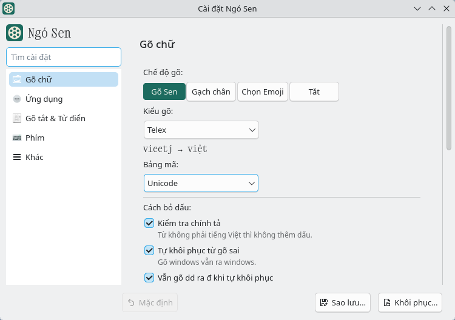

# Ngó Sen

**Bộ gõ tiếng Việt cho fcitx5 trên Linux.**

- **Không cần quyền đặc biệt.** Ngó Sen không còn uinput server, chỉ dùng đúng quyền của fcitx5. Cài
  xong gõ được ngay, không phải bật service hay cấp quyền thiết bị.
- **Gõ thẳng, không gạch chân.** Chế độ Gõ Sen đưa chữ vào app ngay khi gõ. Gợi ý ở thanh địa chỉ
  hay ô tìm kiếm hiện ra theo từng phím gõ.
- **Một chế độ cho hầu hết app.** Trình duyệt, terminal, Zalo, LibreOffice đều dùng Gõ Sen. Ngó Sen tự nhận ra
  app nhận chữ kiểu gì, không phải đổi chế độ.
- **Lõi Rust.** Phần biến `tieengs` thành `tiếng` được viết lại bằng Rust. Gói cho Fedora, Arch, openSUSE
  và Ubuntu 24.04 trở lên dùng lõi Rust.
- **Cài bằng một dòng lệnh.** Có cho Fedora, Ubuntu, Debian, Arch, CachyOS và openSUSE. Script so hash
  SHA-256 trước khi cài.
- **Cửa sổ cài đặt theo giao diện máy.** Sáng hay tối, KDE hay GNOME, cửa sổ dùng giao diện đang có.
  Đổi gì lưu ngay, có nút Hoàn tác.

<picture>
  <source media="(prefers-color-scheme: dark)" srcset="docs/screenshots/settings-dark.png">
  
</picture>

Gặp lỗi thì báo ở mục [Issues](https://github.com/ngosen/ngosen/issues). Những gì sắp làm nằm ở
[ROADMAP.md](ROADMAP.md).

## Chỉ cho fcitx5

Ngó Sen chỉ làm cho fcitx5. fcitx5 chạy được trên GNOME, KDE, Xfce lẫn Sway, Hyprland, có nhiều tính năng
và nhẹ RAM. Làm cho một bộ gõ nền cũng đỡ công giữ nhiều bản. Mã bản IBus cũ vẫn còn ở nhánh
`feat/ibus-engine`.

## Nên dùng chế độ nào

Dùng **Gõ Sen** làm chế độ gõ chính: trong cửa sổ cài đặt Ngó Sen, trang Gõ chữ, chọn Gõ Sen ở hàng
Chế độ gõ. Chế độ này trước đây tên là `Uinput`; cấu hình cũ tự chuyển sang tên mới. Chế độ Surrounding
Text cũ cũng tự chuyển thành Gõ Sen.

Kiểu gõ được dùng và test hằng ngày là **Telex**. VNI và các kiểu khác dùng được nhưng chưa test kỹ.

## Cài

Một dòng lệnh, cho Fedora, Ubuntu, Debian, Kali, Arch, CachyOS và openSUSE Tumbleweed trên máy x86_64; Fedora,
Ubuntu, Debian và Kali có cả gói cho máy ARM 64-bit (aarch64):

```
curl -fsSL https://raw.githubusercontent.com/ngosen/ngosen/main/install.sh | bash
```

Lệnh này tải gói cho đúng distro từ
[release mới nhất](https://github.com/ngosen/ngosen/releases/latest), hỏi lại rồi mới cài. Muốn lên version
mới thì chạy lại đúng lệnh đó; cấu hình cũ giữ nguyên.

Trên GNOME (desktop mặc định của Ubuntu), lệnh cài còn đặt fcitx5 làm bộ gõ thay cho IBus, thêm Ngó Sen vào
danh sách bộ gõ và bật extension sửa lỗi gõ khi cần. Nếu GNOME không có khay hệ thống (như trên Fedora),
lệnh cài thêm extension [Input Method Panel](https://extensions.gnome.org/extension/261/) để icon và menu bộ
gõ hiện trên thanh trên cùng.

Trên KDE Plasma (Wayland), lệnh cài chọn fcitx5 làm bàn phím ảo của KDE (System Settings → Virtual
Keyboard), để app Qt như Kate, Dolphin cũng gõ được. Trên Xfce, Cinnamon, MATE (X11, Debian và Ubuntu), lệnh
cài dùng im-config đặt fcitx5 làm bộ gõ.

Ở mọi desktop trên, lệnh cài thêm Ngó Sen vào danh sách bộ gõ. Cài xong chỉ cần đăng xuất rồi đăng nhập
lại, sau đó bấm Ctrl+Space (phím mặc định của fcitx5) để bật tiếng Việt. Các bước này chỉ áp dụng cho tài
khoản đang chạy lệnh; tài khoản khác trên cùng máy thì đăng nhập vào đó rồi chạy lại lệnh cài.

Muốn tự làm các bước đó thì cài bằng
`curl -fsSL https://raw.githubusercontent.com/ngosen/ngosen/main/install.sh | bash -s -- --no-setup`.

Không muốn chạy lệnh tải từ mạng thì tải gói ở trang
[Releases](https://github.com/ngosen/ngosen/releases) rồi cài bằng tay. Muốn tự build từ source thì xem
[TU-DUNG.md](TU-DUNG.md).

Muốn test tính năng chưa có trong release thì cài [version thử](https://github.com/ngosen/ngosen/releases/tag/next-build),
build tự động mỗi khi nhánh `next` thay đổi:

```
curl -fsSL https://raw.githubusercontent.com/ngosen/ngosen/next/install.sh | NGOSEN_RELEASE_URL=https://github.com/ngosen/ngosen/releases/download/next-build bash
```

Trên NixOS, thêm flake của repo này vào cấu hình rồi đưa gói vào danh sách addon của fcitx5. Nix build gói
từ source trong repo:

```nix
# flake.nix
inputs.ngosen.url = "github:ngosen/ngosen";

# configuration.nix, với inputs truyền qua specialArgs
i18n.inputMethod = {
  enable = true;
  type = "fcitx5";
  fcitx5.addons = [ inputs.ngosen.packages.${pkgs.stdenv.hostPlatform.system}.default ];
};
```

CI build gói này, chạy test và nạp nó vào fcitx5 trên một màn hình X ảo, nhưng chưa ai test trên máy
NixOS thật. Gặp lỗi thì mở issue. Muốn build từ bản clone trên máy: xem mục NixOS trong
[TU-DUNG.md](TU-DUNG.md#nixos).

**Mỗi lần cập nhật, và khi cài bằng `--no-setup` hay cài gói bằng tay,** khởi động lại fcitx5:

```
fcitx5 -rd
```

KDE Wayland: đăng xuất rồi đăng nhập lại thay cho lệnh trên, vì fcitx5 bật bằng `fcitx5 -rd` không gõ
được trong app Qt như Kate, Dolphin.

### Ubuntu 26.04: extension sửa lỗi gõ

Có từ version `0.5.0-1`. Lệnh cài ở trên tự bật extension này trên GNOME 50.0 đến 50.3. Nếu cài gói bằng tay,
đăng xuất rồi đăng nhập lại, sau đó chạy một lần:

```
gnome-extensions enable forward-keys@ngosen.github.io
```

Khi Ubuntu tự sửa lỗi này ([báo lỗi trên Launchpad](https://bugs.launchpad.net/ubuntu/+source/mutter/+bug/2169784))
thì tắt extension bằng `gnome-extensions disable forward-keys@ngosen.github.io`.

### Ubuntu: VS Code

Nên cài VS Code bằng gói `.deb` từ [trang của Microsoft](https://code.visualstudio.com/download) hoặc
bằng Flatpak từ [Flathub](https://flathub.org/apps/com.visualstudio.code). Hai bản này gõ được tiếng
Việt ngay, không cần chỉnh gì.

Bản snap (cài từ App Center) không mang theo phần nối với fcitx5, nên gõ ra chữ Telex thô (`tieengs`).
Nếu buộc phải dùng snap, cho nó đi qua XIM (đường nối kiểu cũ của X11): chép file `.desktop` của nó vào
thư mục nhà rồi sửa dòng mở app:

```
cp /var/lib/snapd/desktop/applications/code_code.desktop ~/.local/share/applications/
sed -i 's|^Exec=/snap/bin/code|Exec=env GTK_IM_MODULE=xim XMODIFIERS=@im=fcitx /snap/bin/code|' \
  ~/.local/share/applications/code_code.desktop
```

Tắt hẳn VS Code rồi mở lại từ menu. Qua XIM, khoảng một câu trong mười có một chữ bị sai dấu. Muốn bỏ
cách này thì xoá file `~/.local/share/applications/code_code.desktop`.

## Gỡ

Một dòng lệnh, hỏi lại rồi mới gỡ:

```
curl -fsSL https://raw.githubusercontent.com/ngosen/ngosen/main/install.sh | bash -s -- --uninstall
```

Trên GNOME, lệnh này còn trả lại những gì lệnh cài đã đổi cho tài khoản đang chạy: fcitx5 thôi tự chạy
khi đăng nhập, app dùng lại IBus, tắt extension sửa lỗi gõ và gỡ Input Method Panel nếu lệnh cài đã thêm.
Đăng xuất rồi đăng nhập lại là GNOME dùng IBus như cũ. File nào đã bị sửa tay sau khi cài thì lệnh gỡ để
nguyên. fcitx5
vẫn còn trên máy; muốn gỡ luôn thì chạy `sudo apt autoremove` (Ubuntu, Debian) sau đó.

Trên Xfce, Cinnamon, MATE, lệnh gỡ trả bộ gõ về mặc định của máy; fcitx5 còn cài thì có thể vẫn tự chạy,
gỡ hẳn bằng `sudo apt remove fcitx5`. Trên KDE, fcitx5 vẫn là bàn phím ảo, vì có thể đang dùng cho bộ gõ
khác; muốn bỏ thì chọn None ở System Settings → Virtual Keyboard.

Gỡ bằng tay:

1. Bỏ Ngó Sen khỏi danh sách bộ gõ trong "Fcitx5 Configuration".
2. Gỡ gói rồi khởi động lại fcitx5:

   ```
   sudo dnf remove fcitx5-ngosen       # Fedora
   sudo apt remove fcitx5-ngosen       # Ubuntu, Debian
   sudo pacman -R fcitx5-ngosen        # Arch, CachyOS
   sudo zypper remove fcitx5-ngosen    # openSUSE
   fcitx5 -rd
   ```

Cấu hình (các file `ngosen*.conf` trong `~/.config/fcitx5/conf/`, và `lotus*.conf` nếu từng dùng version trước
1.1.0) vẫn ở lại máy, để lần cài sau dùng tiếp. Muốn xoá sạch thì xoá các file đó.

## Nguồn gốc

Người giữ dự án chỉ **vibecode**: nêu việc cho trợ lý AI viết mã, rồi đo và dùng nó hằng ngày.

Dựa trên mã của [fcitx5-lotus](https://github.com/LotusInputMethod/fcitx5-lotus) và
[VMK](https://github.com/thanhpy2009/VMK). Giấy phép GPL-3.0-or-later.

Lõi gõ có hai bản, đều giấy phép MIT: bản Rust là [bamboo-core](https://github.com/bamboo-vi/bamboo-core)
của [@nguyen10t2](https://github.com/nguyen10t2), dùng trong mọi gói trừ gói cho Debian 12; bản Go là
[bamboo-core](https://github.com/BambooEngine/bamboo-core) của [@t1ld3x](https://github.com/t1ld3x), dùng trong gói
cho Debian 12.

Issue và pull request trước ngày 10/10/2026 nằm ở repo lưu trữ
[ngosen/ngosen-fork-archive](https://github.com/ngosen/ngosen-fork-archive).

## English

Ngó Sen is a Vietnamese input method for fcitx5. The maintainer only **vibecodes** this project: the
code is written with an AI coding agent, then measured and used daily by the maintainer. It is licensed
under GPL-3.0-or-later and published as is, with no promise of support.

Since 1.0, Ngó Sen has no background uinput server; two typing modes, Gõ Sen (one mode that works for
fast typing, browsers and Electron apps) and Preedit; and the Bamboo composition core ported from Go to Rust.
Both cores are MIT licensed: the Rust [bamboo-core](https://github.com/bamboo-vi/bamboo-core) by
[@nguyen10t2](https://github.com/nguyen10t2), used by most packages, and the Go
[bamboo-core](https://github.com/BambooEngine/bamboo-core) by [@t1ld3x](https://github.com/t1ld3x), used by the Debian 12
package.
Ngó Sen targets fcitx5 only; the IBus engine was dropped and stays unmaintained on the
`feat/ibus-engine` branch. The rest of this page is in Vietnamese.
