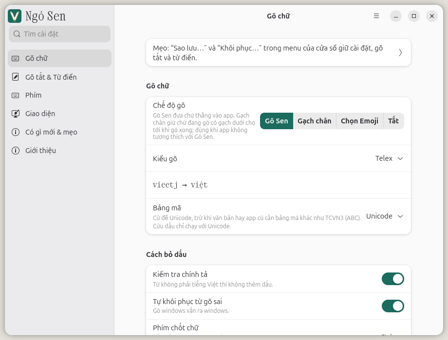
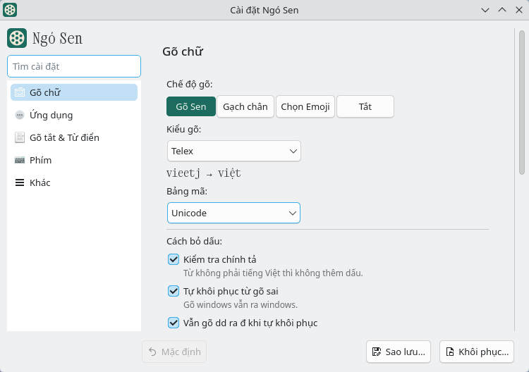

<div align="center">


# Ngó Sen

**Bộ gõ tiếng Việt cho Linux, gõ tự nhiên và mượt mà như UniKey trên Windows.**

[](https://github.com/ngosen/ngosen/releases/latest)
[](LICENSE)
[](#cai-dat)

[Cài đặt](#cai-dat) · [Tính năng](#tinh-nang) · [Khắc phục sự cố](#khac-phuc-su-co) · [CHANGELOG](CHANGELOG.md) · [Báo lỗi](https://github.com/ngosen/ngosen/issues)

</div>

---

Ngó Sen hỗ trợ đầy đủ hai nền tảng:

- **fcitx5** (khuyên dùng): chạy mượt mà trên GNOME, KDE Plasma, Xfce, Sway, Hyprland và niri; giàu tính năng
  và nhẹ RAM.
- **IBus** ([ibus-ngosen](https://github.com/ngosen/ibus-ngosen)): tích hợp trực tiếp vào IBus mặc định
  của GNOME, dùng chung lõi gõ với bản fcitx5 nên có hầu hết tính năng tương đương. Tính năng mới có thể
  đến bản IBus muộn hơn.

Cửa sổ cài đặt có hai giao diện: **GTK** (tự mở trên GNOME, Linux Mint Cinnamon và Xfce) và **Qt** (mở
trên KDE Plasma và các desktop khác). Cửa sổ theo giao diện sáng/tối của máy, lưu thay đổi ngay và có nút
Hoàn tác.

<table>
  <tr>
    <th>Bản GTK trên GNOME</th>
    <th>Bản Qt trên KDE Plasma</th>
  </tr>
  <tr>
    <td>
      <picture>
        <source media="(prefers-color-scheme: dark)" srcset="docs/screenshots/settings-gtk-dark.png">
        
      </picture>
    </td>
    <td>
      <picture>
        <source media="(prefers-color-scheme: dark)" srcset="docs/screenshots/settings-dark.png">
        
      </picture>
    </td>
  </tr>
</table>

## Mục lục

- [✨ Tính năng nổi bật](#tinh-nang)
- [💡 Lựa chọn chế độ gõ](#che-do-go)
- [📦 Cài đặt](#cai-dat)
  - [Cài đặt tự động](#cai-tu-dong)
  - [Chọn bản fcitx5 hoặc IBus](#chon-ban)
  - [Cài qua trình quản lý gói](#trinh-quan-ly-goi)
  - [Cài trên NixOS](#nixos)
  - [Cài bằng tay, tự build, bản thử](#cai-bang-tay)
- [🛠️ Thiết lập sau khi cài đặt](#thiet-lap)
- [🔍 Khắc phục sự cố thường gặp](#khac-phuc-su-co)
- [🗑️ Gỡ cài đặt](#go-cai-dat)
- [🏛️ Nguồn gốc & ghi công](#nguon-goc)
- [English](#english)

<a id="tinh-nang"></a>

## ✨ Tính năng nổi bật

- **Cứu chữ:** quên bật tiếng Việt và gõ nhầm `tieengs vieetj`? Chỉ cần bấm phím chuyển sang tiếng Việt,
  chữ sẽ đổi thành `tiếng việt`. Nhấn `Tab` hoặc `Esc` để lấy lại chữ đã gõ. Cứu chữ không ghi nhớ gì
  trong ô mật khẩu.
- **Cứu dấu:** bôi đen chữ rồi bấm phím dấu thanh để thêm, đổi hoặc bỏ dấu (`nhanh` + `s` → `nhánh`). Ở
  chế độ Gõ Sen, chỉ cần bấm chuột ngay sau từ (`nhanh|` + `s`) là sửa được dấu mà không cần bôi đen.
- **Menu chế độ riêng cho từng app:** nhấn phím `` ` `` để mở menu cạnh con trỏ, chọn **Gõ Sen (1)**,
  **Gạch chân (q)**, **Chọn Emoji (w)** hoặc **Tắt (e)**. Ngó Sen nhớ lựa chọn riêng cho từng app.
- **Gõ thẳng không gạch chân (Gõ Sen):** chữ vào app ngay khi gõ; gợi ý ở thanh địa chỉ hay ô tìm kiếm
  hiện theo từng phím.
- **Nhận ra tiếng Anh:** chữ không thể thành tiếng Việt thì hiện lại đúng phím đã gõ. Đo bằng Telex, cài
  đặt mặc định, trên 9.884 từ tiếng Anh thông dụng: 92,9% đúng ngay khi gõ, 96,9% đúng sau khi bấm Space.
  Muốn giữ từ tiếng Anh trùng cách gõ tiếng Việt thì gõ đúp phím dấu (`thiss` → `this`).
- **Chèn emoji:** gõ từ khoá tiếng Anh (`smile`, `heart`), danh sách emoji hiện cạnh con trỏ để chọn nhanh
  bằng số.
- **Phím chuyển Anh/Việt riêng:** cài mới dùng `Ctrl + Shift` như UniKey, người dùng cũ giữ
  `Ctrl + Space`. Mỗi app nhớ riêng đang gõ Anh hay Việt.
- **Phím chốt chữ (Ctrl):** bấm rồi thả `Ctrl` để giữ nguyên từ đang gõ, không thêm dấu hay bung gõ tắt.
- **Gõ tắt (macro):** tự theo chữ hoa: `ko` → `không` thì gõ `Ko` sẽ ra `Không`.
- **Trang "Kiểm tra máy":** tìm lỗi thiết lập của desktop, cho biết còn mấy việc cần sửa và sửa từng việc
  bằng một nút bấm.

Chi tiết từng version ở [CHANGELOG.md](CHANGELOG.md), những gì sắp làm ở [ROADMAP.md](ROADMAP.md).

<a id="che-do-go"></a>

## 💡 Lựa chọn chế độ gõ

1. **Gõ Sen (khuyên dùng):** đưa chữ thẳng vào app, không gạch chân. Ngó Sen tự nhận ra cách trình duyệt,
   terminal, Zalo, LibreOffice nhận chữ để xử lý cho đúng, không cần đổi chế độ.
2. **Preedit (Gạch chân):** giữ từ đang gõ trong vùng gạch chân rồi mới đưa vào app.

> [!TIP]
> Mở cài đặt Ngó Sen → trang **Gõ chữ** → chọn **Gõ Sen** ở hàng Chế độ gõ. Kiểu gõ **Telex** được dùng và
> test hằng ngày; VNI và các kiểu khác dùng được nhưng chưa test kỹ.

<a id="cai-dat"></a>
<a id="cài"></a>

## 📦 Cài đặt

<a id="cai-tu-dong"></a>

### 1. Cài đặt tự động (khuyên dùng)

Hỗ trợ Fedora, Ubuntu (từ 24.04), Debian (từ 12), Kali, deepin, LMDE, Devuan, Parrot, Arch, Artix, CachyOS
và openSUSE Tumbleweed trên `x86_64`. Fedora, Ubuntu, Debian và Kali có thêm gói `aarch64`.

```bash
curl -fsSL https://raw.githubusercontent.com/ngosen/ngosen/main/install.sh | bash
```

Lệnh tải gói đúng distro từ [release mới nhất](https://github.com/ngosen/ngosen/releases/latest), kiểm tra
SHA-256, hỏi lại trước khi cài và tự thiết lập theo desktop đang dùng. Chạy lại lệnh này để cập nhật version
mới; cấu hình cũ giữ nguyên. Thiết lập chỉ áp dụng cho tài khoản chạy lệnh.

Sau khi cài, nhấn rồi thả `Ctrl + Shift` để chuyển giữa tiếng Anh và tiếng Việt; biểu tượng khay hiện chữ V
khi đang gõ tiếng Việt.

<details>
<summary>Lệnh cài làm gì trên từng desktop</summary>

- **GNOME:** đặt fcitx5 thay IBus, bật extension sửa lỗi gõ khi cần. Nếu không có khay hệ thống (như
  Fedora), thêm extension [Input Method Panel](https://extensions.gnome.org/extension/261/) để icon và
  menu bộ gõ hiện trên thanh trên cùng.
- **KDE Plasma (Wayland):** chọn fcitx5 ở System Settings → Virtual Keyboard để app Qt như Kate, Dolphin
  cũng gõ được.
- **Xfce, Cinnamon, MATE** (X11, Debian và Ubuntu): dùng im-config đặt fcitx5 làm bộ gõ.
- **Sway, Hyprland, niri:** chạy lệnh từ terminal trong phiên desktop để thêm Ngó Sen và bật fcitx5, không
  cần đăng xuất. Lệnh không sửa file config của desktop; để fcitx5 tự chạy ở lần đăng nhập sau, dán dòng lệnh được in ra.

Desktop khác: cài xong thì đăng xuất rồi đăng nhập lại.

</details>

<a id="chon-ban"></a>

### 2. Chọn bản fcitx5 hoặc IBus

Khi cài lần đầu trên GNOME, hoặc Xfce, Cinnamon, MATE dùng X11 ở Debian, Ubuntu, Linux Mint, lệnh cài hỏi
chọn bản nào. Nhấn Enter là chọn bản fcitx5. Muốn chọn thẳng:

```bash
# Bản fcitx5
curl -fsSL https://raw.githubusercontent.com/ngosen/ngosen/main/install.sh | bash -s -- --fcitx5

# Bản IBus
curl -fsSL https://raw.githubusercontent.com/ngosen/ngosen/main/install.sh | bash -s -- --ibus
```

<details>
<summary>Bản IBus khác gì, và khi chuyển bản thì sao</summary>

Bản IBus có Gõ Sen, kiểu gõ, gõ tắt, từ điển riêng, bảng phím tùy chỉnh và chọn Gõ Sen hay Gạch chân riêng
cho từng app (phím `` ` ``). Các điểm còn khác: chưa có emoji và Vim mode. Cứu dấu dùng được ở ô gõ bằng Gõ
Sen (bấm ngay sau một chữ rồi gõ phím dấu); đổi dấu chữ đang bôi đen chỉ được ở app X11. Cứu chữ hiện chỉ có
trên X11. Trong một số app, từ đang gõ có gạch chân.

Chạy lại lệnh cài để cập nhật thì giữ bản đang có, không hỏi lại. Muốn chuyển sang bản kia, chạy lệnh với
`--ibus` hoặc `--fcitx5`. Dùng `--yes` thì lệnh không hỏi và cài bản fcitx5.

Hai package không cài cùng nhau được; chuyển bản sẽ gỡ package của bản kia cho mọi tài khoản trên máy. Trên
Debian, Ubuntu và Fedora, package cũ được gỡ trong cùng lần cài, nên cài lỗi thì bản cũ vẫn còn. Trên openSUSE
và Arch, lệnh dừng và in lệnh gỡ package kia; gỡ xong thì chạy lại lệnh cài.

Từ fcitx5 sang IBus: bản IBus chép kiểu gõ, gõ tắt, bảng phím và từ điển tùy chỉnh ở lần chạy đầu, lệnh cài
thêm “Tiếng Việt (Ngó Sen)” vào nguồn nhập của GNOME. Từ IBus sang fcitx5: cài đặt không tự chép sang, hãy sao
lưu trong cửa sổ cài đặt của bản IBus rồi khôi phục trong bản fcitx5. Sau khi chuyển, đăng xuất rồi đăng nhập
lại.

Xem thêm ở [README của bản IBus](https://github.com/ngosen/ibus-ngosen#readme).

</details>

<a id="trinh-quan-ly-goi"></a>

### 3. Cài qua trình quản lý gói

Mỗi release đều có trên repo có chữ ký, nên version mới đến qua update của hệ thống (`dnf upgrade`,
`apt upgrade`, `pacman -Syu`, `zypper up`). Các repo dùng chung key có fingerprint
`6D4A 2075 F985 3BE8 F6B6 FE7E 7550 1858 158B 36CD`.

Đã cài bằng lệnh một dòng thì chỉ cần thêm repo. Máy chưa có Ngó Sen thì cài gói xong làm theo mục
[Thiết lập sau khi cài đặt](#thiet-lap).

**Fedora (COPR, x86_64 và aarch64):**

```bash
sudo dnf copr enable nguyenphi/ngosen
sudo dnf install fcitx5-ngosen
```

**Debian, Ubuntu, Linux Mint, MX (APT, x86_64 và arm64):**

```bash
sudo curl -fsSL -o /usr/share/keyrings/ngosen.gpg https://ngosen.github.io/ngosen/apt/ngosen.gpg
echo "deb [signed-by=/usr/share/keyrings/ngosen.gpg] https://ngosen.github.io/ngosen/apt $(. /etc/os-release && echo ${UBUNTU_CODENAME:-$VERSION_CODENAME}) main" | sudo tee /etc/apt/sources.list.d/ngosen.list
sudo apt update
sudo apt install fcitx5-ngosen
```

> [!NOTE]
> Kali: thay phần `$(. /etc/os-release && echo ${UBUNTU_CODENAME:-$VERSION_CODENAME})` bằng `forky`. deepin 23
> và 25: thay bằng `bookworm`. LMDE, Devuan, Parrot: thay bằng bản Debian gốc, `bookworm` hoặc `trixie` (xem
> `/etc/debian_version`: 12 là `bookworm`, 13 là `trixie`).

**Arch, CachyOS, EndeavourOS (pacman, x86_64):**

```bash
curl -fsSL https://ngosen.github.io/ngosen/arch/ngosen.asc | sudo pacman-key --add -
sudo pacman-key --lsign-key 6D4A2075F9853BE8F6B6FE7E75501858158B36CD
printf '\n[ngosen]\nServer = https://ngosen.github.io/ngosen/arch/$arch\n' | sudo tee -a /etc/pacman.conf
sudo pacman -Syu fcitx5-ngosen
```

**openSUSE Tumbleweed (zypper, x86_64):**

```bash
sudo zypper addrepo https://ngosen.github.io/ngosen/opensuse/ngosen.repo
sudo zypper refresh
sudo zypper install fcitx5-ngosen
```

zypper hỏi một lần có tin cậy key không; đối chiếu fingerprint rồi chọn tin cậy.

Bản IBus cũng có trong repo APT, pacman và zypper: thay `fcitx5-ngosen` bằng `ibus-ngosen` trong lệnh cài.

<a id="nixos"></a>

### 4. Cài trên NixOS

Thêm flake vào cấu hình; Nix build từ source trong repo:

```nix
# flake.nix
inputs.ngosen.url = "github:ngosen/ngosen";

# configuration.nix, với inputs truyền qua specialArgs
i18n.inputMethod = {
  enable = true;
  type = "fcitx5";
  fcitx5.addons = [ inputs.ngosen.packages.${pkgs.stdenv.hostPlatform.system}.default ];
};
```

Muốn build từ bản clone trên máy, xem mục NixOS trong [TU-DUNG.md](TU-DUNG.md#nixos).

<a id="cai-bang-tay"></a>

### 5. Cài bằng tay, tự build, bản thử

- Tự thiết lập desktop: thêm `--no-setup` vào lệnh cài
  (`... | bash -s -- --no-setup`).
- Không muốn chạy lệnh tải từ mạng: tải gói ở [Releases](https://github.com/ngosen/ngosen/releases) và cài
  bằng tay.
- Tự build từ source: xem [TU-DUNG.md](TU-DUNG.md).
- Test tính năng chưa có trong release: cài [version thử](https://github.com/ngosen/ngosen/releases/tag/next-build),
  build tự động khi nhánh `next` thay đổi:

  ```bash
  curl -fsSL https://raw.githubusercontent.com/ngosen/ngosen/next/install.sh | NGOSEN_RELEASE_URL=https://github.com/ngosen/ngosen/releases/download/next-build bash
  ```

<a id="thiet-lap"></a>
<a id="thiết-lập-sau-khi-cài-package"></a>

## 🛠️ Thiết lập sau khi cài đặt

Cài từ repo, từ package tải về hoặc dùng `--no-setup` thì chưa thêm Ngó Sen vào danh sách bộ gõ. Làm các
bước sau (hoặc chạy lệnh cài một dòng ở trên để nó làm giúp):

- **Thêm Ngó Sen vào danh sách bộ gõ:** mở “Cấu hình Fcitx 5” (`fcitx5-configtool`), tab bộ gõ, thêm
  “Ngó Sen”. Máy để ngôn ngữ tiếng Việt thì fcitx5 tự thêm ở lần chạy đầu.
- **Khởi động lại bộ gõ** sau mỗi lần cài hoặc cập nhật: chạy `fcitx5 -rd`. Trên KDE Wayland, đăng xuất rồi
  đăng nhập lại thay cho lệnh này.
- **GNOME:** đặt fcitx5 tự chạy khi đăng nhập và nạp biến môi trường, rồi đăng xuất và đăng nhập lại:

  ```sh
  mkdir -p ~/.config/autostart ~/.config/environment.d
  [ -e /etc/xdg/autostart/org.fcitx.Fcitx5.desktop ] || cp /usr/share/applications/org.fcitx.Fcitx5.desktop ~/.config/autostart/
  printf 'GTK_IM_MODULE=fcitx\nQT_IM_MODULE=fcitx\nXMODIFIERS=@im=fcitx\nSDL_IM_MODULE=fcitx\n' > ~/.config/environment.d/90-ngosen.conf
  ```

  Thanh trên cùng không có icon bộ gõ thì cài extension
  [Input Method Panel](https://extensions.gnome.org/extension/261/). Xem thêm
  [extension sửa lỗi gõ](#gnome-extension).
- **KDE Plasma (Wayland):** chọn **Fcitx 5** ở *System Settings → Virtual Keyboard*, rồi đăng xuất và đăng
  nhập lại. App X11 chạy qua XWayland (như Minecraft bản cũ) cần thêm
  `echo 'XMODIFIERS=@im=fcitx' > ~/.config/environment.d/90-ngosen.conf` trước khi đăng xuất.
- **Xfce, Cinnamon, MATE** (Debian, Ubuntu, Mint): chạy `im-config -n fcitx5`, rồi đăng xuất và đăng nhập lại.
- **Sway, Hyprland, niri:** chạy lệnh cài một dòng từ terminal trong phiên desktop để được thiết lập sẵn.

<a id="khac-phuc-su-co"></a>
<a id="lỗi-thường-gặp"></a>

## 🔍 Khắc phục sự cố thường gặp

<a id="gnome-extension"></a>
<a id="gnome-extension-sửa-lỗi-gõ"></a>
<a id="ubuntu-2604-extension-sửa-lỗi-gõ"></a>

### GNOME mất phím hoặc không nhớ chế độ gõ theo app

Gói có kèm extension `forward-keys@ngosen.github.io` cho GNOME 46 đến 50. Chỉ cần bật nó trong ba trường hợp:
GNOME 50.0–50.3 (GNOME làm mất phím bộ gõ gửi cho app,
[báo lỗi trên Launchpad](https://bugs.launchpad.net/ubuntu/+source/mutter/+bug/2169784)), máy không có gói
`xdg-desktop-portal-gnome`, hoặc muốn nhớ chế độ gõ cho app không có tệp `.desktop`. Lệnh cài tự bật ở hai
trường hợp đầu. Bật bằng tay: đăng xuất, đăng nhập lại rồi chạy một lần

```bash
gnome-extensions enable forward-keys@ngosen.github.io
```

### Chromium trên Wayland mất chữ khi bấm chuột

Ở chế độ Preedit trên GNOME Wayland, Chrome, Chromium và app Electron mất chữ đang gõ dở khi bấm chuột. Lỗi
ở fcitx5 5.1.19 trở về trước, đã sửa ở 5.1.20
([báo lỗi trên Launchpad](https://bugs.launchpad.net/ubuntu/+source/fcitx5/+bug/2172006)). Trong lúc distro
chưa có bản mới, dùng chế độ **Gõ Sen**, hoặc gõ xong chữ bằng phím cách rồi mới bấm chuột.

### VS Code trên Ubuntu

Nên dùng gói `.deb` từ [trang của Microsoft](https://code.visualstudio.com/download) hoặc
[Flatpak](https://flathub.org/apps/com.visualstudio.code), gõ được ngay. Bản snap gõ ra Telex thô (`tieengs`);
nếu buộc phải dùng snap, cho nó đi qua XIM:

```bash
cp /var/lib/snapd/desktop/applications/code_code.desktop ~/.local/share/applications/
sed -i 's|^Exec=/snap/bin/code|Exec=env GTK_IM_MODULE=xim XMODIFIERS=@im=fcitx /snap/bin/code|' \
  ~/.local/share/applications/code_code.desktop
```

Tắt hẳn VS Code rồi mở lại từ menu. Qua XIM, khoảng một câu trong mười có một chữ sai dấu. Muốn bỏ cách này
thì xoá file `~/.local/share/applications/code_code.desktop`.

### Gặp lỗi khác

Báo ở [Issues](https://github.com/ngosen/ngosen/issues). Không có tài khoản GitHub thì nhắn trang
[Facebook](https://www.facebook.com/profile.php?id=61595753582618): trong cửa sổ cài đặt, vào trang
“Kiểm tra máy”, bấm “Nhắn qua Facebook…” để chép sẵn thông tin máy rồi dán vào tin nhắn.

<a id="go-cai-dat"></a>

## 🗑️ Gỡ cài đặt

Lệnh hỏi lại rồi mới gỡ, và trả lại thiết lập desktop mà lệnh cài đã đổi:

```bash
curl -fsSL https://raw.githubusercontent.com/ngosen/ngosen/main/install.sh | bash -s -- --uninstall
```

Hoặc gỡ bằng trình quản lý gói rồi chạy `fcitx5 -rd`:

```bash
sudo dnf remove fcitx5-ngosen       # Fedora
sudo apt remove fcitx5-ngosen       # Ubuntu, Debian
sudo pacman -R fcitx5-ngosen        # Arch, CachyOS
sudo zypper remove fcitx5-ngosen    # openSUSE
```

Cấu hình được giữ lại để lần cài sau dùng tiếp: các file `ngosen*.conf` trong `~/.config/fcitx5/conf/` (và
`lotus*.conf` nếu từng dùng version trước 1.1.0). Muốn dọn sạch thì xoá các file đó.

<details>
<summary>Gỡ trên từng desktop</summary>

- **GNOME:** fcitx5 thôi tự chạy khi đăng nhập, app dùng lại IBus, tắt extension sửa lỗi gõ và gỡ Input Method
  Panel nếu lệnh cài đã thêm. Đăng xuất rồi đăng nhập lại. fcitx5 vẫn còn; muốn gỡ luôn thì chạy
  `sudo apt autoremove` (Ubuntu, Debian).
- **Xfce, Cinnamon, MATE:** trả bộ gõ về mặc định của máy; gỡ hẳn fcitx5 bằng `sudo apt remove fcitx5`.
- **KDE:** giữ fcitx5 làm bàn phím ảo vì có thể đang dùng cho bộ gõ khác; muốn bỏ thì chọn None ở System
  Settings → Virtual Keyboard.
- **Sway, Hyprland, niri:** bỏ dòng đã dán vào config, rồi đăng xuất và đăng nhập lại.

</details>

<a id="nguon-goc"></a>

## 🏛️ Nguồn gốc & ghi công

- Dựa trên mã của [fcitx5-lotus](https://github.com/LotusInputMethod/fcitx5-lotus) và
  [VMK](https://github.com/thanhpy2009/VMK), giấy phép **GPL-3.0-or-later**.
- Lõi biến `tieengs` thành `tiếng` là bản Rust [bamboo-core](https://github.com/bamboo-vi/bamboo-core) của
  [@nguyen10t2](https://github.com/nguyen10t2), port từ bản Go
  [bamboo-core](https://github.com/BambooEngine/bamboo-core) của [@t1ld3x](https://github.com/t1ld3x)
  (giấy phép **MIT**). Mọi gói Ngó Sen, kể cả Debian 12, đều dùng bản Rust.
- Danh sách từ tiếng Anh trong lõi lấy từ [SCOWL](https://wordlist.aspell.net) của Kevin Atkinson.
- Issue và pull request trước ngày 10/10/2026 nằm ở repo lưu trữ
  [ngosen/ngosen-fork-archive](https://github.com/ngosen/ngosen-fork-archive).

### Lấy mã hay ý tưởng từ Ngó Sen

- Chép hay sửa mã của Ngó Sen thì giữ giấy phép **GPL-3.0-or-later** và ghi nguồn, kể cả khi nhờ AI đọc mã
  rồi viết lại.
- Đưa cách làm của Ngó Sen sang bộ gõ khác (cách xoá chữ trong từng loại app, cách nhận ra ô địa chỉ trình
  duyệt…), kể cả khi chỉ lấy ý tưởng, thì ghi nguồn kèm link tới repo này trong README hoặc ghi chú phát hành.

<a id="english"></a>

## English

Ngó Sen is a Vietnamese input method for fcitx5. The maintainer only **vibecodes** this project: an AI coding
agent writes the code, then the maintainer measures and uses it daily. It is licensed under GPL-3.0-or-later.

Ngó Sen has two typing modes, Gõ Sen (for fast typing, browsers and Electron apps) and Preedit, and uses the
Rust [bamboo-core](https://github.com/bamboo-vi/bamboo-core) by [@nguyen10t2](https://github.com/nguyen10t2),
ported from the original Go [bamboo-core](https://github.com/BambooEngine/bamboo-core) by
[@t1ld3x](https://github.com/t1ld3x). Both projects are MIT licensed. The core's English word list comes from
[SCOWL](https://wordlist.aspell.net) by Kevin Atkinson.

It includes Cứu chữ to retype what was typed before switching to Vietnamese, and Cứu dấu to change the tone
mark of a selected word. [Ngó Sen for GNOME](https://github.com/ngosen/ibus-ngosen) runs on GNOME's built-in
IBus and shares the same typing core. If you reuse Ngó Sen's code, keep the GPL and its notices, including when
an AI tool rewrites it. If you port its approaches to another input method, credit this repository with a link.
The rest of this page is in Vietnamese.
